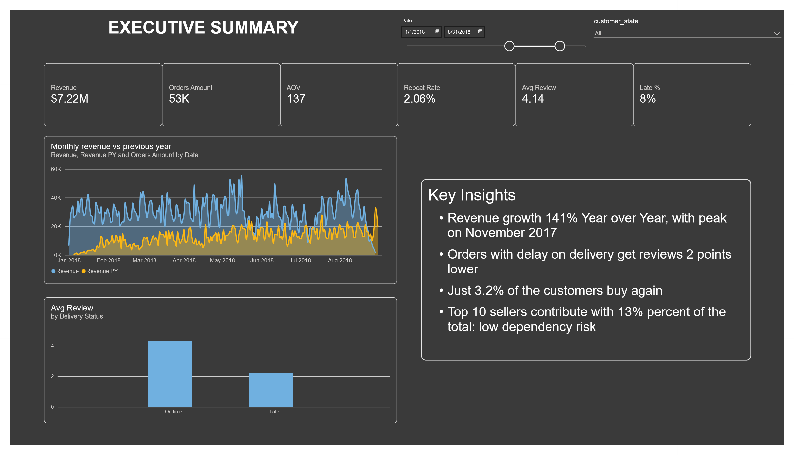
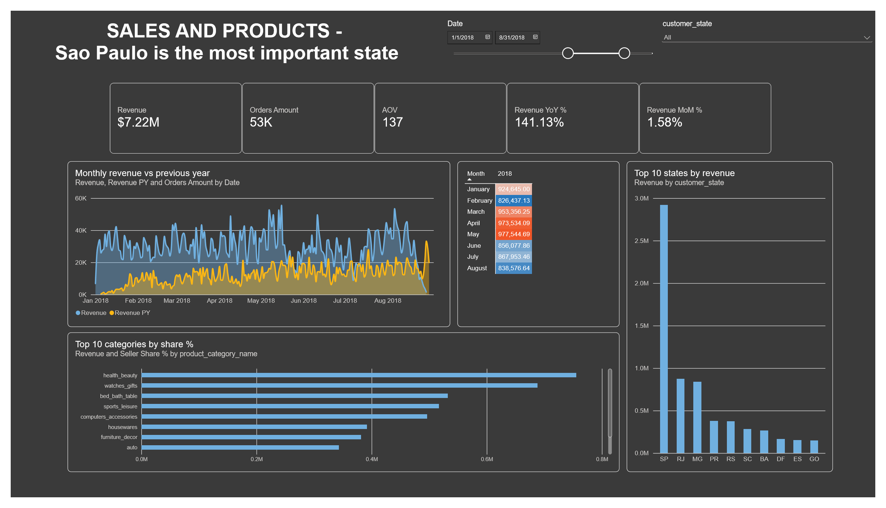
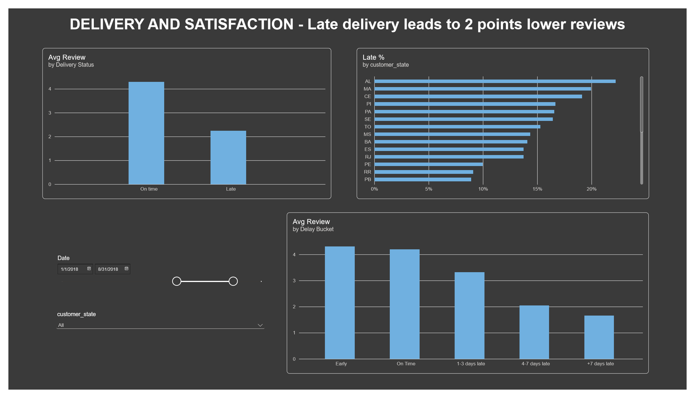
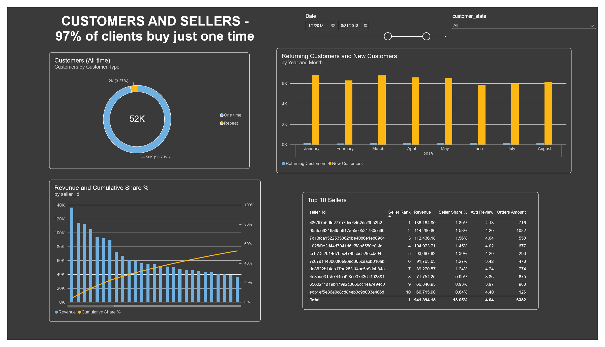
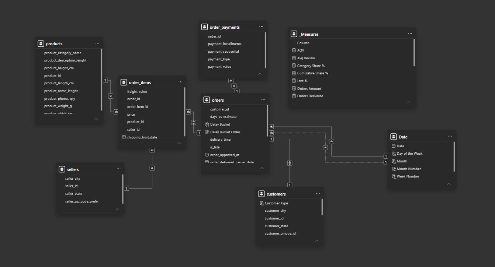

# Olist E-commerce Dashboard: Power BI

A Power BI report for a mid-size Brazilian marketplace that knows *"sales are growing, but we don't know where we're losing money and customers."*

Built on the [Olist Brazilian E-commerce dataset](https://www.kaggle.com/datasets/olistbr/brazilian-ecommerce) (~100K orders, 9 tables, 2016–2018).



## Key findings (Jan–Aug 2018)
| Question | Answer |
|---|---|
| Revenue trend and seasonality | **+141% YoY**, with steady monthly revenue of ~$0.9M. Peak in Nov 2017 (Black Friday). |
| Top categories and states | **São Paulo is ~40% of revenue.** Health & beauty, watches & gifts and bed/bath lead the categories. |
| Delivery vs reviews | Late orders score **~2 points lower** (2.3 vs 4.3). The Northeast has the most late deliveries (AL 22%). |
| Repeat customers | **96.8% buy only once** (3.2% repeat). Growth depends on acquisition. |
| Seller dependency | Top 10 sellers hold only **13%** of revenue, so dependency risk is low. |

Full write-up: [Findings and recommendations](docs/findings.md)

## Report pages
| Sales and products | Delivery and satisfaction |
|---|---|
|  |  |
| **Customers and sellers** | **Data model** |
|  |  |

## How it was built
- **Power Query:** type fixes, English category names, delivery-time columns (`delivery_time`, `days_vs_estimate`, `is_late`), and reviews aggregated per order.
- **Model:** star schema with `order_items` as the fact table, dimensions for orders, products, sellers and customers, and a marked Date table with active and inactive relationships.
- **DAX:** Revenue, AOV, Late %, Avg Review (`CROSSFILTER`), Repeat Rate, time intelligence (PY, YoY, MoM, YTD), seller share, Top-10 share and a Pareto cumulative share.
- **Key decisions:** only delivered orders are counted, customers are identified by `customer_unique_id`, and YoY compares equal periods.

Details: [Data model and dictionary](docs/data-model.md) · [Project brief](docs/brief.md)

## Repository
```
├── README.md
├── docs/
│   ├── brief.md          # client problem, questions, assumptions, scope
│   ├── data-model.md     # star schema, dictionary, cleaning, DAX
│   └── findings.md       # insights and recommendations for the client
├── images/               # report screenshots
├── LOG.md                # work log and decisions, day by day
└── brazilian-ecommerce-report.pdf
```

## Data and license
The data belongs to Olist and is published on Kaggle under **CC BY-NC-SA 4.0**. Raw CSVs are not included in this repo. Download them from Kaggle to rebuild the report.

## Tools
Power BI Desktop · Power Query (M) · DAX
