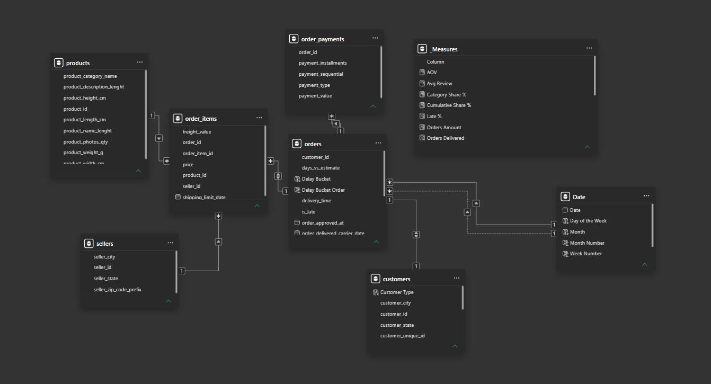

# Data Model and Dictionary



## Star schema
**Fact table:** `order_items` has one row per product within an order.

| Table | Type | Key | Description |
|---|---|---|---|
| `order_items` | Fact | `order_id` + `order_item_id` | Price, freight, product, seller, shipping limit date |
| `orders` | Dimension | `order_id` | Status, timestamps, delivery columns, review score |
| `products` | Dimension | `product_id` | Category (English), size, weight |
| `sellers` | Dimension | `seller_id` | Seller city and state |
| `customers` | Dimension | `customer_id` | Customer city and state, `customer_unique_id` |
| `order_payments` | Related to `orders` | `order_id` | Payment type, installments, value |
| `Date` | Date table (marked) | `Date` | Year, Month, Month Number, Week Number, Day of the Week |
| `_Measures` | Measure table | – | All DAX measures |

## Relationships
- `products`, `sellers` and `orders` → `order_items` (1:*, single direction)
- `customers` → `orders` (1:*)
- `Date[Date]` → `orders[order_purchase_timestamp]` (**active**)
- `Date[Date]` → other order dates (**inactive**, used with `USERELATIONSHIP`)
- `Avg Review` uses `CROSSFILTER(..., BOTH)` so product and seller filters reach `orders` without a bidirectional relationship.

## Cleaning decisions (Power Query)
- Loaded every CSV through a `FolderPath` parameter. Removed the `olist_` prefix from table names.
- Translated product categories to English by merging with the translation table.
- Fixed duplicated city spellings (`são paulo`).
- Converted all date/time columns to **Date** type, including `shipping_limit_date`, which arrived as text. The relationships to `Date` require matching types.
- Grouped reviews by `order_id` and merged the score into `orders`. Comment text was ignored.
- Dropped the geolocation table.

## Calculated columns
| Column | Table | Logic |
|---|---|---|
| `delivery_time` | orders | Days from purchase to delivery |
| `days_vs_estimate` | orders | Delivered date minus estimated date (positive means late) |
| `is_late` | orders | 1 = late, 0 = on time, null = not delivered |
| `Delivery Status` | orders | "On time" / "Late" for delivered orders, blank otherwise |
| `Delay Bucket` / `Delay Bucket Order` | orders | Early · On time · 1-3 · 4-7 · +7 days late (sorted) |
| `Customer Type` | customers | "Repeat" if the `customer_unique_id` has more than 1 delivered order, otherwise "One-time" |
| `First Order Date` | customers | First delivered purchase per `customer_unique_id` |

## Key measures
```dax
Revenue      = CALCULATE( SUM( order_items[price] ), orders[order_status] = "delivered" )
Orders Amount= CALCULATE( DISTINCTCOUNT( order_items[order_id] ), orders[order_status] = "delivered" )
AOV          = DIVIDE( [Revenue], [Orders Amount] )
Avg Review   = CALCULATE( AVERAGE( orders[review_score] ),
                 CROSSFILTER( order_items[order_id], orders[order_id], BOTH ),
                 orders[order_status] = "delivered" )
Late %       = CALCULATE( AVERAGE( orders[is_late] ), orders[order_status] = "delivered" )
Revenue PY   = CALCULATE( [Revenue], SAMEPERIODLASTYEAR( 'Date'[Date] ) )
Revenue YoY %= DIVIDE( [Revenue] - [Revenue PY], [Revenue PY] )
Revenue MoM %= DIVIDE( [Revenue] - [Revenue PM], [Revenue PM] )
Seller Share %        = DIVIDE( [Revenue], CALCULATE( [Revenue], ALL( sellers ) ) )
Top 10 Sellers Share  = DIVIDE( SUMX( TOPN( 10, ALL( sellers[seller_id] ), [Revenue] ), [Revenue] ),
                                CALCULATE( [Revenue], ALL( sellers ) ) )
Cumulative Share %    = running revenue of sellers ranked ≥ current / total revenue (Pareto)
```
**Repeat rate, two definitions.** The `Repeat Rate` measure counts customers with more than one delivered order *inside the selected period*, so it changes with the slicers. The `Customer Type` calculated column is computed once over the *whole history* and ignores the slicers. That is why the KPI card (2.1%, Jan–Aug 2018) and the donut (3.3%, all time) show different values.

Also included: Repeat Customers, Repeat Rate, New Customers, Returning Customers, Revenue YTD and Category Share %.
